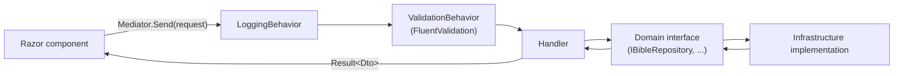
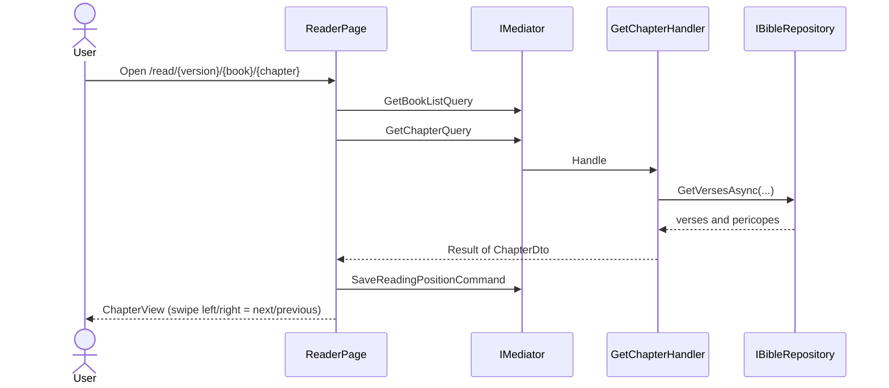
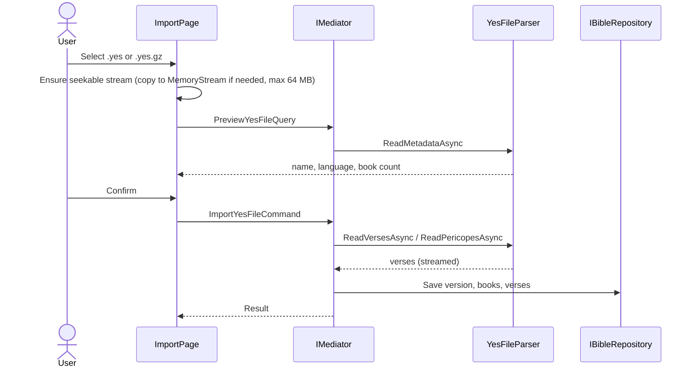
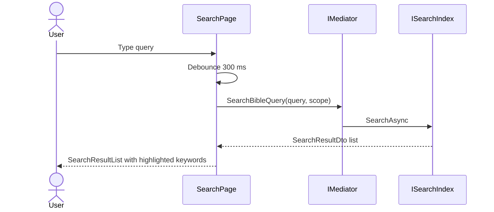
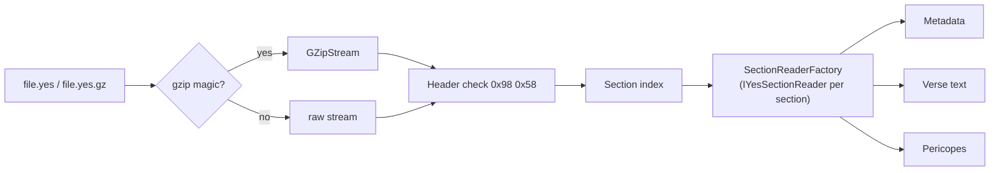

# OpenBible

> Offline-first **.NET 10 Blazor WebAssembly PWA** that ports the open-source [androidbible (Alkitab)](https://github.com/yukuku/androidbible) by Yuku to the web.

OpenBible reads Bible translations entirely on the client. After the first load, the app shell is served by a service worker and all scripture, search, bookmarks and highlights work without a network connection. Target platform: iOS Safari standalone PWA (also works in desktop and Android browsers).

- [Status](#status)
- [Features](#features)
- [Architecture](#architecture)
- [Runtime flows](#runtime-flows)
- [Verse addressing (ARI)](#verse-addressing-ari)
- [The `.yes` file format](#the-yes-file-format)
- [Mapping from androidbible](#mapping-from-androidbible)
- [Offline and PWA design](#offline-and-pwa-design)
- [Project structure](#project-structure)
- [Build, test and run](#build-test-and-run)
- [Testing strategy](#testing-strategy)
- [Roadmap](#roadmap)
- [Credits and license](#credits-and-license)

---

## Status

The solution builds with zero warnings and all tests pass. Implemented versus pending:

| Area | State |
|---|---|
| Domain model, ARI value object, repository contracts | Implemented |
| Application use cases (read, import, search, bookmarks, highlights, reading position) | Implemented |
| UI pages: Reader, Library, Import, Search; swipe navigation; dark mode; safe-area layout | Implemented |
| `.yes` header/metadata/verse parsing with transparent GZip | Implemented (basic) |
| `.yes` parsing: metadata, books, verse text, `snappy-blocks`, pericopes, footnotes, xrefs, `.yes.gz` | Implemented (see [ADR 0003](docs/adr/0003-yes-file-format-spec.md)) |
| Persistence | Implemented. In-memory working stores are snapshotted to IndexedDB (JS interop) and restored at startup; the search index is rebuilt on restore |
| Bundled full KJV (public domain) imported on first run, so the reader works out of the box | Implemented |
| CI workflow, trimming/Brotli tuning, offline end-to-end verification | Pending |

See [PLAN.md](PLAN.md) for the authoritative checklist.

## Features

- **Reader**: chapter view, pericope headings, previous/next chapter by swipe or buttons, book selector, auto-resume of the last reading position.
- **Verse actions**: highlight with colors, toggle bookmark, copy text.
- **Backup &amp; restore** (More menu): downloads a single versioned JSON file with reading positions, bookmarks, highlights, notes, labels, progress marks, plan progress and the default version, and restores it by replacing the current user data. An invalid file is rejected and nothing changes. Installed Bible texts and display settings are not part of the backup; reinstall versions from Library.
- **Library (Bible versions)**: list installed versions, set the default version (stored under `openbible.settings`), list bookmarks, delete a version, open Import, and browse the bundled official Alkitab catalog. "Install" downloads a catalog file through the `OpenBible.Server` host (`GET /api/catalog/download/{preset}`, restricted to bundled presets and the official `alkitab-host.appspot.com` / `boafiles.kejut.com` hosts) and imports it directly into the local database. Run it with `dotnet run --project src/OpenBible.Server`. Catalog hosts send no CORS headers, so on static hosting without the server use "Manual download" and then Import. Offline reading never needs the server.
- **Import**: preview a `.yes` / `.yes.gz` file (metadata) before importing it (64 MB limit).
- **Search**: debounced (300 ms) full-text search with scope filter (All / Old Testament / New Testament / Current book) and keyword highlighting.
- **PWA polish**: iOS safe-area insets, system dark/light mode plus manual toggle, service worker with cache-first strategy for published assets.

## Architecture

OpenBible uses **Onion (Clean) Architecture** with **CQRS through MediatR**. Dependencies only point inward.

```mermaid
flowchart TB
    subgraph Wasm["OpenBible.Wasm (Presentation)"]
        UI["Razor pages and components<br/>inject IMediator only"]
        SW["Service worker, manifest, JS interop"]
    end
    subgraph Infra["OpenBible.Infrastructure"]
        YES["YesFileParser + section readers<br/>GZip detection"]
        REPO["Bible repository, user-data repository and search index<br/>(all in-memory today)"]
        IDX["SimpleSearchIndex"]
        SEED["BundledBibleSeeder"]
    end
    subgraph App["OpenBible.Application"]
        UC["Commands, Queries, Handlers"]
        PIPE["LoggingBehavior, ValidationBehavior"]
        DTO["DTOs and Result&lt;T&gt;"]
    end
    subgraph Dom["OpenBible.Domain"]
        ENT["Entities and Value Objects<br/>VerseReference (ARI), VerseRange"]
        IFC["Contracts: IBibleRepository, IYesFileReader,<br/>ISearchIndex, IUserDataRepository"]
    end

    UI --> UC
    UC --> IFC
    UC --> ENT
    Infra -. implements .-> IFC
    Wasm -. registers in Program.cs .-> Infra
    Infra --> App
```

| Project | Responsibility | References |
|---|---|---|
| `OpenBible.Domain` | Entities, value objects, enums, exceptions, repository/reader contracts. No external dependencies except `MediatR.Contracts`. | none |
| `OpenBible.Application` | Use cases as MediatR requests, pipeline behaviors, DTOs, `Result<T>`. | Domain |
| `OpenBible.Infrastructure` | `.yes` parsing, search index, repository implementations, seeding. | Domain, Application |
| `OpenBible.Wasm` | Blazor WASM host, pages, components, CSS, service worker. Composition root (`AddApplication().AddInfrastructure()`). | Application (via `IMediator`), Infrastructure (DI registration only) |

Rules enforced by convention (details in [AGENTS.md](AGENTS.md)):

1. Razor components inject `IMediator` and never repositories or parsers.
2. Handlers return DTOs or `Result<T>`; domain entities never reach `.razor` files.
3. Every I/O method is `async Task`, takes a `CancellationToken`, and non-UI layers use `ConfigureAwait(false)`.
4. No sync-over-async; `.yes` files are streamed section by section, never loaded fully into a byte array.
5. One type per file; tests never touch the network.

## Runtime flows

### Request pipeline

Every UI action becomes a MediatR request that passes through the same pipeline.



### Reading a chapter



Opening `/` queries `GetReadingPositionQuery` and redirects to the last position (or a default chapter). Routes: `/`, `/read`, `/read/{VersionId}/{Book:int}/{Chapter:int}[/{Verse:int}]`.

### Importing a `.yes` file



### Search



The upstream search semantics (AND over space-separated terms, substring match, case-insensitive, normalized query and text) are the reference; see the androidbible [search guide](https://github.com/yukuku/androidbible/blob/develop/docs/modules/search.md).

### Bookmarks and highlights

Long-pressing a verse opens `VerseActionSheet`, which sends `SetVerseHighlightCommand` or `ToggleBookmarkCommand` (copy uses a JS helper). The Library page lists them via `GetBookmarksQuery`. Markers are keyed by the verse ARI, as in androidbible's [markers guide](https://github.com/yukuku/androidbible/blob/develop/docs/modules/markers.md).

## Verse addressing (ARI)

A verse is identified by a 32-bit **ARI** (Alkitab Resource Identifier):

```
ari = (bookId << 16) | (chapter << 8) | verse
```

| Field | Range | Notes |
|---|---|---|
| `bookId` | 0-65 | zero-based, Genesis = 0, Revelation = 65 |
| `chapter` | 1-based | 0 means the whole book |
| `verse` | 1-based | 0 means the whole chapter |

Example: Genesis 1 (whole chapter) is `0x000100` = `256`. All bit math is encapsulated in the `VerseReference` value object (`ToAri()` / `FromAri(int)`); Application and UI code never shifts bits.

## The `.yes` file format

`.yes` (YES2) is the single-file Bible translation format of androidbible. Key facts, based on the upstream [binary formats guide](https://github.com/yukuku/androidbible/blob/develop/docs/binary-formats.md):

```
[Header]         8 bytes, starts with 0x98 0x58
[Section index]  count + (name, offset, attributes size, content size) per section
[Sections...]    version info, book info, verse text, pericopes, xrefs, footnotes
[Footer]         1 byte
```

- Numbers are **big-endian** (Java `DataInputStream`); OpenBible reads them via `BigEndianBinaryReader`.
- Verse text is UTF-8 or ASCII, may be Snappy-compressed and is addressed per book/chapter through offset tables for random access.
- A whole file may be GZip-wrapped (`.yes.gz`); OpenBible detects the `0x1F 0x8B` magic and wraps the stream in `GZipStream`.
- Inline formatting codes (red letters, footnote markers, ...) are part of the verse text; see the upstream [text rendering guide](https://github.com/yukuku/androidbible/blob/develop/docs/text-rendering.md).



Each section has its own reader so new sections can be added without modifying the core parser (Open/Closed). Snappy blocks are decoded by a managed decoder (no native dependency), and footnotes/xrefs are attached to verses through the ARIF index. Section names follow the upstream names (`versionInfo`, `booksInfo`, `text`, `xrefs`, `footnotes`, `pericopes`). Changes to the parser or ARI logic should be discussed first.

## Mapping from androidbible

| androidbible (Android) | OpenBible (.NET 10) |
|---|---|
| `Activity` / `Fragment` | Blazor page (`Pages/ReaderPage.razor`) |
| Custom view / adapter | Blazor component (`Components/ChapterView.razor`) |
| `ViewModel` / `LiveData` | MediatR query + DTO |
| `Ari` utility | `VerseReference` value object |
| `Yes2Reader` | `YesFileParser` implementing `IYesFileReader` |
| `InternalDb` / SQLite | `IBibleRepository` / `IUserDataRepository` (in-memory working store with IndexedDB snapshots) |
| `SharedPreferences` | `IUserDataRepository` (reading position, theme) |
| Version ids `internal`, `preset/<name>`, `file/<path>` | `BibleVersion` ids in the catalog |
| `DataInputStream` (big-endian) | `BinaryPrimitives.ReadInt32BigEndian` |

Upstream references: [architecture](https://github.com/yukuku/androidbible/blob/develop/docs/architecture.md), [storage](https://github.com/yukuku/androidbible/blob/develop/docs/storage.md), [versions](https://github.com/yukuku/androidbible/blob/develop/docs/modules/versions.md).

## Offline and PWA design

- `manifest.webmanifest` with `display: standalone` and Apple meta tags in `index.html`.
- `service-worker.published.js` precaches published assets with a cache-first strategy.
- `openbible.css` uses `env(safe-area-inset-*)` and `prefers-color-scheme`; `MainLayout` adds a manual theme toggle and an `ErrorBoundary`.
- No runtime network calls: tests and app logic must run with zero connectivity.
- Offline reload and service-worker behaviour still need end-to-end verification (see Status).

## Project structure

```
OpenBible.sln
Directory.Build.props        shared settings (net10.0, nullable, warnings as errors)
Directory.Packages.props     central package management
global.json                  .NET SDK pin
src/
  OpenBible.Domain/          entities, value objects, contracts
  OpenBible.Application/     use cases, behaviors, DTOs, Result
  OpenBible.Infrastructure/  YesFile parser, repositories, search, seeder
  OpenBible.Wasm/            Blazor WASM host (Pages, Components, Layout, wwwroot)
tests/
  OpenBible.Domain.Tests/
  OpenBible.Application.Tests/
  OpenBible.Infrastructure.Tests/
PLAN.md                      milestone checklist
AGENTS.md                    architecture rules and porting guide
```

## Build, test and run

Requires the .NET 10 SDK (see `global.json`).

```bash
dotnet restore
dotnet build --no-incremental     # zero warnings, zero errors
dotnet test --no-build            # all tests, fully offline
dotnet run --project src/OpenBible.Wasm
```

### Docker

One image serves the PWA and the catalog download API (`OpenBible.Server`) on port 8080. The KJV is bundled, so a fresh container is readable offline after the first load.

```bash
docker compose up --build            # http://localhost:8080 (set OPENBIBLE_PORT to change)
docker pull ghcr.io/pradikta/openbible:latest
```

Service workers need HTTPS except on `localhost`, so put the container behind a TLS reverse proxy for real deployments.

### CI and images

Two workflows share the work. [`.github/workflows/ci.yml`](.github/workflows/ci.yml) only verifies: it builds and tests, validates the compose file, and smoke tests the image with [`tools/smoke_test.sh`](tools/smoke_test.sh) on both `amd64` and `arm64` (the ARM64 image runs under QEMU, since the target Portainer host is ARM64). It runs on pull requests and can be called by other workflows. [`.github/workflows/deploy.yml`](.github/workflows/deploy.yml) runs on pushes to `main` and `v*` tags: it calls `ci.yml` first, and once that passes it pushes a multi-arch image to `ghcr.io/pradikta/openbible` (`latest`, version tags, short SHA) without attestation manifests so Portainer can pull it. Pull requests never push anything.

**GitHub setup:** no secrets or environments are required. The workflow logs in to GHCR with the built-in `GITHUB_TOKEN` and requests `packages: write` itself, so nothing needs configuring in *Settings → Secrets and variables*. Two optional steps:

- After the first publish, open the package (*Packages → openbible → Package settings*) and set the visibility to public if Portainer should pull without credentials. A private package needs a registry login in Portainer using a personal access token with `read:packages`.
- If the package already exists from another source, grant this repository write access under *Package settings → Manage Actions access*.

A Portainer redeploy step is not part of `deploy.yml`. If added later, it would need a `PORTAINER_WEBHOOK_URL` secret (preferably on a protected environment such as `PRD`).

### Styling (Tailwind CSS)

The UI uses Tailwind CSS v4 with a responsive shell (bottom tab bar on phones, sidebar from `md` up). The source is `src/OpenBible.Wasm/Styles/tailwind.css`; the generated `wwwroot/css/tailwind.css` is committed, so building the .NET solution does not need Node. After changing Razor classes or the stylesheet, rebuild it:

```bash
cd src/OpenBible.Wasm
npm install        # first time only
npm run build:css
```

## Testing strategy

xUnit, NSubstitute and FluentAssertions. Domain tests cover ARI math and value-object equality; Application tests mock the Domain contracts to test handlers; Infrastructure tests exercise the parser and repositories. No test performs network access.

## Roadmap

Study features (notes, labels, progress marks, bundled sample reading plans and devotions, verse compare, display settings, share and go-to-reference) are implemented through MediatR handlers in `OpenBible.Application/Study` and persisted under the IndexedDB key `openbible.study`. Open items, tracked in [PLAN.md](PLAN.md): `GetVerseQuery` and version-metadata query, import progress, side-by-side chapter panes, CI workflow, and end-to-end offline verification.

## Credits and license

Open-source under the [MIT License](LICENSE). Based on logic and specifications from [androidbible (Alkitab)](https://github.com/yukuku/androidbible) by Yuku.
