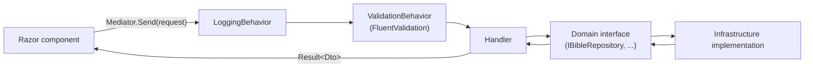
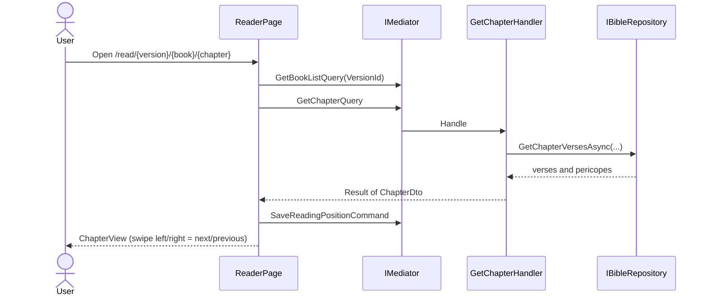
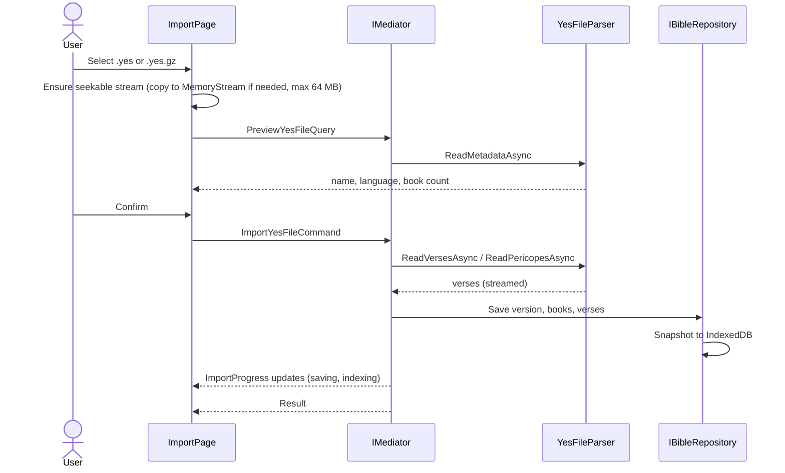
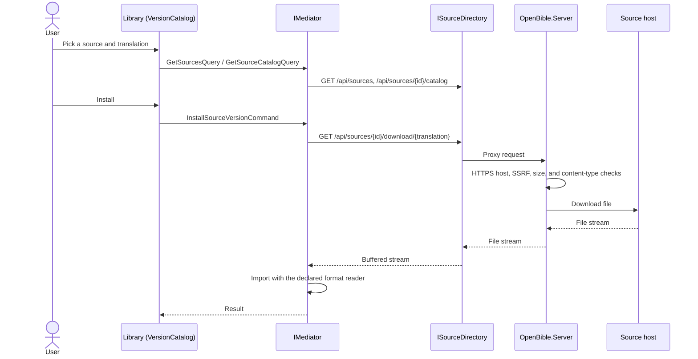
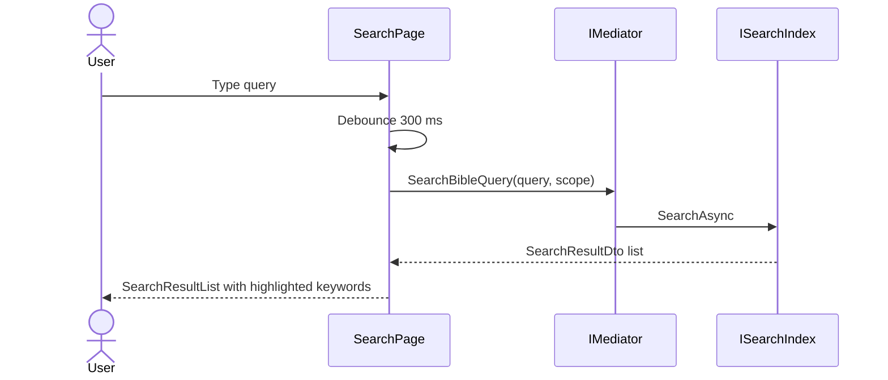
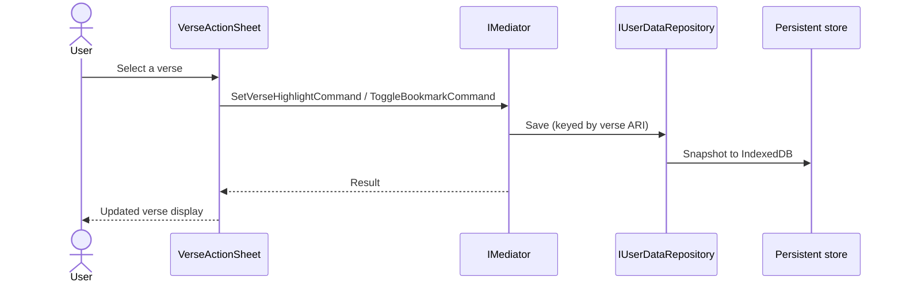
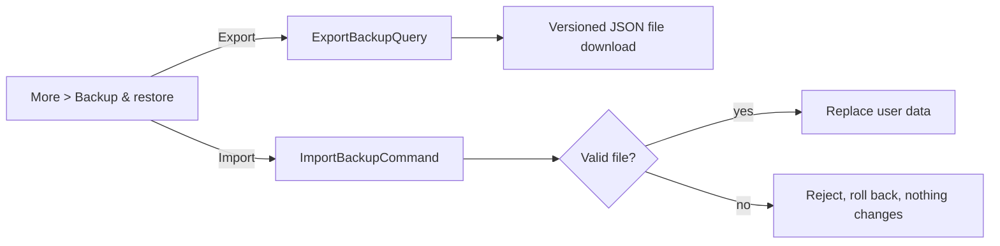
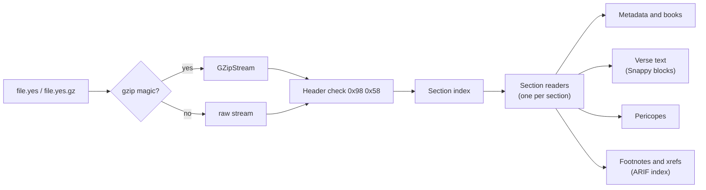
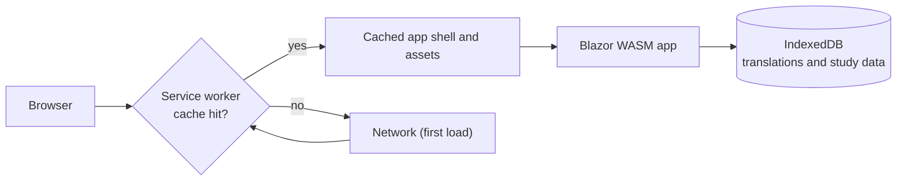
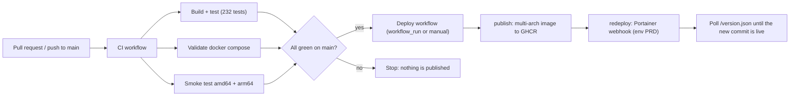

# OpenBible

OpenBible is an **offline-first Bible reader** built with .NET 10, Blazor WebAssembly, and the Progressive Web App (PWA) platform. It brings selected features and the `.yes` Bible format used by [androidbible (Alkitab)](https://github.com/yukuku/androidbible) to the web.

The app is designed for personal, non-commercial use. Bible translation files may have separate rights and terms; see [Personal use and content rights](#personal-use-and-content-rights).

The reader, search, and personal study data run in the browser. The app needs an initial connection to load; after installation and caching, core reading works offline. Catalog downloads require a connection.

- [Status](#status)
- [Features](#features)
- [Personal use and content rights](#personal-use-and-content-rights)
- [Get started](#get-started)
- [Using OpenBible](#using-openbible)
- [Offline use and stored data](#offline-use-and-stored-data)
- [Backup and restore](#backup-and-restore)
- [Architecture](#architecture)
- [Runtime flows](#runtime-flows)
- [Verse addressing (ARI)](#verse-addressing-ari)
- [The `.yes` file format](#the-yes-file-format)
- [Mapping from androidbible](#mapping-from-androidbible)
- [Offline and PWA design](#offline-and-pwa-design)
- [Developer guide](#developer-guide)
- [Testing](#testing)
- [CI and deployment](#ci-and-deployment)
- [Known limitations and roadmap](#known-limitations-and-roadmap)
- [Credits](#credits)

---

## Status

The solution builds with zero warnings and all tests pass (Domain 41, Application 70, Infrastructure 121; 232 in total). Implemented versus pending:

| Area | State |
|---|---|
| Domain model, ARI value object, repository contracts | Implemented |
| Application use cases (read, import, search, bookmarks, highlights, reading position, study data, catalog, backup) | Implemented |
| UI pages: Reader, Library, Import, Search, and the More tools; swipe navigation; dark mode; safe-area layout | Implemented |
| `.yes` parsing: metadata, books, verse text, `snappy-blocks`, pericopes, footnotes, xrefs, `.yes.gz` | Implemented (see [ADR 0003](docs/adr/0003-yes-file-format-spec.md)) |
| Persistence: working stores snapshotted to IndexedDB and restored at startup; the search index is rebuilt on restore | Implemented |
| Empty by default: no bundled Bible text or catalog | Implemented |
| Deployment-configured source registry and protected download proxy | Implemented |
| YES (`.yes`/`.yes.gz`) and USFM (ZIP or single file) readers | Implemented |
| SWORD (zText/zText4, ZIP, KJV versification) reader | Implemented |
| Automatic format detection for manual import | Implemented |
| Live catalog cache and scheduled refresh (YES/USFM/SWORD adapters) | Implemented |
| Install-time license confirmation and storage | Implemented |
| Backup and restore of personal data | Implemented |
| CI workflow, Docker image, GHCR publishing, Portainer redeploy | Implemented |
| Import progress UI | Implemented |
| Trimming/Brotli tuning | Implemented |
| Side-by-side chapter comparison | Implemented |
| Memory profiling | Pending |
| Offline end-to-end verification on physical devices | Pending |
| Downloadable plans/devotions, sync, songs | Not started |

## Features

- **Reader**: chapter view with pericope headings, previous/next chapter by swipe or buttons, book selector, and automatic resume of the last reading position.
- **Verse actions**: highlight with colors, toggle bookmark, add notes and labels, set progress marks, copy or share verse text.
- **Search**: debounced (300 ms) full-text search with a scope filter (All / Old Testament / New Testament / Current book) and keyword highlighting.
- **Study tools**: bundled sample reading plans with progress, daily devotions, per-verse and side-by-side chapter comparison across installed translations, go-to-reference, and display settings.
- **Library (Bible versions)**: list installed versions, set the default version, list bookmarks, delete a version, open Import, and browse translations from the deployment-configured source registry with one-click install through `OpenBible.Server`.
- **Import**: preview a `.yes`, `.yes.gz`, USFM (`.usfm`/`.sfm` or a ZIP), or SWORD package before importing it (64 MB limit), with format detection and a streaming progress bar while verses are saved and indexed.
- **Backup and restore** (More menu): export personal data to one versioned JSON file and restore it later; see [Backup and restore](#backup-and-restore).
- **Data management**: clear history, or run a confirmed factory reset that removes all local app data.
- **PWA polish**: iOS safe-area insets, system dark/light mode plus a manual toggle, and a service worker with a cache-first strategy for published assets.
- **Deployment**: single Docker image (web app plus catalog API) for `amd64` and `arm64`, published to GHCR.

## Personal use and content rights

OpenBible is intended for **personal, non-commercial use only**. Do not sell access to this app, offer it as a paid service, or use it for commercial purposes.

This statement describes the intended use of this project; it does not grant rights to third-party software, Bible translations, catalogs, or other content. Each translation may have its own copyright, license, and redistribution restrictions. Check and follow the applicable terms before importing, sharing, or redistributing translation files. OpenBible ships no Bible text; you provide the translations you install.

There is no `LICENSE` file in this repository. Do not assume that the upstream Alkitab project’s license or a translation’s terms automatically apply to OpenBible or to content you install.

### Translation licenses are the user's responsibility

- **You are responsible** for confirming that you may download, store, use, or share every translation you install or import. This applies to source downloads, `.yes` files you obtain elsewhere, and any copy you host yourself.
- **The developer and contributors are not responsible** for the content, accuracy, copyright status, or licensing of any translation, and accept no liability for how users or operators use them. The software is provided as is, without warranty.
- OpenBible does not host translation files. Source items are fetched on demand from third-party hosts that are outside this project's control and may change over time.
- Source metadata may carry little or no rights information, and OpenBible does not verify rights for any entry. The absence of a notice does not mean a translation is free to use. Check the owner or publisher of each translation (for example the Bible society, Wycliffe/SIL, or the original translator) before relying on it.
- If you host OpenBible publicly or for others, you are the operator and are responsible for the translations your instance offers. Remove or disable any source entries you do not have the right to distribute.
- If you are a rights holder and want a source entry removed, contact the upstream catalog maintainers; for this repository, open an issue.

## Get started

### Run locally

Install the [.NET 10 SDK](https://dotnet.microsoft.com/download/dotnet/10.0), then run from the repository root. To try the Library source browser, copy the placeholder example registry and replace the host/catalog with a source you are authorized to use:

```powershell
# Only if you do not already have a local sources.json:
if (-not (Test-Path src/OpenBible.Server/sources.json)) {
    Copy-Item src/OpenBible.Server/sources.example.json src/OpenBible.Server/sources.json
}
dotnet restore
dotnet run --project src/OpenBible.Server
```

`OpenBible.Server` loads `src/OpenBible.Server/sources.json` automatically; set `OPENBIBLE_SOURCES_FILE` to use another path. Edit the copied file to point at a host/catalog you are authorized to use. The file is ignored by git, so each developer can keep their own. Open the local URL, go to **Library**, and install from the configured source. No translation is bundled; without a configured source, use **Import** with a `.yes`, `.yes.gz`, USFM, or SWORD file.

### Run with Docker

Docker serves the web app and its optional source API:

```powershell
docker compose up --build
```

Open `http://localhost:8080` (or the port configured by `OPENBIBLE_PORT`). For more details, see [Docker deployment](#docker-deployment).

### Install as a PWA

Open the app in a supported browser and use its **Install app** or **Add to Home Screen** action. PWA installation and offline caching require a secure context: HTTPS, or `localhost` during local development. Load the app once while online so its shell and static assets can be cached.

## Using OpenBible

1. **Read:** Open the Reader, select a book and chapter, and use the chapter controls or swipe gestures to move between chapters.
2. **Study a verse:** Select a verse to open its actions. Add a bookmark or highlight, create notes and labels, set a progress mark, or copy/share the verse.
3. **Import a translation:** Open **Import**, choose a `.yes` or `.yes.gz` file, review its metadata, then confirm. The current file-size limit is 64 MB.
4. **Search:** Enter terms and optionally limit results to the Old Testament, New Testament, or current book. Select a result to navigate to that passage.
5. **More tools:** Use the More menu for reading plans, daily devotion, verse and chapter comparison, display settings, and backup/restore.
6. **Manage data:** Library lists translations, changes the default, and provides history clearing and a confirmed factory reset. A factory reset deletes local app data.

### Adding translations

OpenBible ships with no Bible text. Add a translation from **Library** (when the deployment configures a source registry) or import a `.yes` / `.yes.gz` file from **Import**. Source downloads go through `OpenBible.Server`; the browser cannot fetch third-party hosts directly because they do not enable CORS.

The Docker image includes the server. On a static host without this API, use manual import. Installing a translation needs internet access; reading an installed translation does not.

### Source registry (optional)

`OpenBible.Server` can expose a deployment-configured source registry for multi-format installs. Configure it with the `Sources` array (environment variables such as `OPENBIBLE_SOURCES__0__ID`, or a mounted JSON file named by `OPENBIBLE_SOURCES_FILE`). `sources.example.json` and `sources/yes-catalog.example.json` are documentation only and are not loaded by default.

- `GET /api/sources` lists configured sources; it is empty by default.
- `GET /api/sources/{sourceId}/catalog` lists translations from a `live` or `file` catalog.
- `GET /api/sources/{sourceId}/download/{translationId}` proxies a download after HTTPS host checks, DNS/SSRF checks, size and content-type limits, with cookies and credentials disabled.

Redirects are disabled rather than followed, so each catalog entry must point at the final HTTPS file URL on the registered host. If a source redirects to a different host, register that final host and use its direct URL.

The app installs from the registry when it is configured; an empty registry leaves manual import as the only path.

#### Deploying a source registry

`OpenBible.Server` reads the registry from ASP.NET Core configuration. Use either environment variables or a mounted JSON file.

**Environment variables** (works well in Portainer, Docker Compose, or a GitHub-managed stack):

```text
OPENBIBLE_SOURCES__0__ID=yes-example
OPENBIBLE_SOURCES__0__DISPLAYNAME=YES example
OPENBIBLE_SOURCES__0__FORMAT=yes
OPENBIBLE_SOURCES__0__HOST=example.org
OPENBIBLE_SOURCES__0__CATALOGKIND=file
OPENBIBLE_SOURCES__0__CATALOGPATH=/config/yes-catalog.json
```

**Mounted JSON file** (same shape as `sources.example.json`, with a top-level `Sources` array):

```yaml
services:
  openbible:
    environment:
      OPENBIBLE_SOURCES_FILE: /config/sources.json
    volumes:
      - ./sources.json:/config/sources.json:ro
```

The file is optional; if the path is unset or the file is absent, the registry is empty. Without `OPENBIBLE_SOURCES_FILE`, the server also loads `sources.json` from its content root automatically. The checked-in `src/OpenBible.Server/sources.example.json` is a copyable template; `sources.json` and `*.local.json` are ignored by git.

The examples use `example.org` placeholders. Do not put real hosts or full download URLs into committed files unless you have verified that the translation's license and the host's terms permit it. Keep real hosts/URLs in the gitignored `sources.json` and `*.local.json` files, and keep license text with the source entry so the app can show it before install.

#### Live catalogs, caching, and refresh

A source with `catalogKind: "live"` fetches its item list from `catalogUrl` (or `https://{Host}{CatalogPath}` when `catalogUrl` is unset) and caches it.

- `catalogFormat`:
  - `catalog-json` — the catalog JSON shape shown above (default).
  - `alkitab-version-config` — Alkitab `version_config.json` (`presets`); use `downloadUrlFormat` to point at the final file host.
  - `ebible-html` — eBible.org `/find/`; only freely redistributable entries are included.
  - `crosswire-bibles-html` — CrossWire "Bible Texts" category; each module is a SWORD ZIP.
- `downloadHost` (defaults to `Host`) and `downloadUrlFormat` (with `$TRANSLATION_ID`) control the URLs built for parsed catalogs. The download URL must be the final HTTPS URL on `downloadHost`; redirects are not followed.
- `refreshMinutes` enables a background refresh; `cacheMinutes` controls how long the cache is served before an on-demand refresh. A failed refresh keeps the last cached copy.
- The cache lives in memory and in `catalog-cache/{sourceId}.json` under the content root. Override the directory with `CatalogCache:Directory` or `OPENBIBLE_CATALOG_CACHE`, and mount a writable volume in Docker/Portainer if the container filesystem is read-only.
- The HTML adapters are best-effort: they depend on upstream markup, terms, and availability. Keep refresh intervals modest (hours, not minutes), respect the host's terms, and prefer a `catalog-json` endpoint you control if the upstream is unstable. The proxy does not send credentials, so only public catalog endpoints are supported.

Example live source (placeholders only):

```json
{
  "id": "example-live",
  "displayName": "Example live source",
  "format": "yes",
  "host": "files.example.org",
  "downloadHost": "files.example.org",
  "catalogKind": "live",
  "catalogUrl": "https://catalog.example.org/yes.json",
  "catalogFormat": "catalog-json",
  "downloadUrlFormat": "https://files.example.org/$TRANSLATION_ID.yes",
  "refreshMinutes": 360,
  "cacheMinutes": 360
}
```

##### GitHub Actions environment variables and secrets

The workflow in this repository builds the image and triggers a Portainer redeploy. It does **not** mutate the running stack, so source configuration must also exist in the Portainer stack environment (or as a mounted file). A common setup is:

1. **Settings → Environments → `PRD` → Environment variables**: store non-sensitive registry values, for example `OPENBIBLE_SOURCES__0__ID`, `OPENBIBLE_SOURCES__0__HOST`, and `OPENBIBLE_SOURCES__0__CATALOGKIND`. Reference them in a workflow as `${{ vars.NAME }}`.
2. **Settings → Environments → `PRD` → Environment secrets**: store credentials only, such as `PORTAINER_WEBHOOK_URL`, `CF_ACCESS_CLIENT_ID`, and `CF_ACCESS_CLIENT_SECRET`. Reference them as `${{ secrets.NAME }}`.
3. **Portainer stack**: set the same `OPENBIBLE_SOURCES__*` keys in the stack environment, or mount `sources.json` and set `OPENBIBLE_SOURCES_FILE`. Mount a writable volume for the catalog cache (or set `OPENBIBLE_CATALOG_CACHE=/data/catalog-cache`). Changing a GitHub variable alone does not update a running container.
4. **GitHub as the source of truth (optional)**: add a deployment step that calls the Portainer API to update the stack environment before redeploying. Keep registry values in environment variables, not secrets, unless the value is actually sensitive.

Do not commit `sources.json`, `*.local.json`, or real host credentials; they are ignored by git and the committed examples use placeholders. The proxy does not forward cookies or credentials, so authenticated or private catalogs are not supported; use a host that serves files without authentication.

## Offline use and stored data

- Scripture text and personal study data are stored locally in the browser using IndexedDB. If browser storage is unavailable, the app has an in-memory fallback; data in that fallback will not survive a reload.
- The search index is built locally and reconstructed from installed translations when the app starts.
- After the first online load and service-worker caching, reading installed translations and using local study features do not require a network connection.
- Installing a catalog translation requires internet access and the catalog API. Imported files are handled in the browser.
- Clearing site data in the browser removes locally stored translations and study data. Use **Backup & restore** to export supported personal data before clearing or moving to another device. Backups do not include Bible text or display settings.
- Offline installation and reload behavior have not yet been verified end-to-end on physical iOS or Android devices; see the [roadmap](#known-limitations-and-roadmap).

## Backup and restore

Open **More → Backup & restore** (route `/backup`).

- **Export** (**Download backup**) saves a single versioned JSON file (`format: "openbible-backup"`, `version: 1`) with a timestamp.
- **Included:** reading positions, bookmarks, highlights, notes, labels, progress marks, reading-plan progress, and the default translation.
- **Not included:** installed Bible texts and display settings. Reinstall translations from Library or Import before or after restoring.
- **Restore** replaces the current personal data with the file's contents. Take a fresh export first if you want to keep what is on the device.
- **Safety:** an invalid file, a different format, or a backup from a newer app version is rejected, and nothing is changed. If applying a file fails midway, the previous data is rolled back.

## Architecture

OpenBible follows Onion Architecture. The Blazor UI sends commands and queries through MediatR; application handlers depend on domain interfaces, and Infrastructure provides their implementations.

```mermaid
flowchart TB
    subgraph Wasm["OpenBible.Wasm (Presentation)"]
        UI["Razor pages and components<br/>inject IMediator only"]
        SW["Service worker, manifest, JS interop"]
    end
    subgraph Infra["OpenBible.Infrastructure"]
        YES["YesFileParser + section readers<br/>GZip detection, Snappy"]
        REPO["Persistent repositories<br/>(Bible, user data, study data, settings)"]
        IDX["SimpleSearchIndex<br/>(rebuilt at startup)"]
    end
    subgraph App["OpenBible.Application"]
        UC["Commands, Queries, Handlers"]
        PIPE["LoggingBehavior, ValidationBehavior"]
        DTO["DTOs and Result&lt;T&gt;"]
    end
    subgraph Dom["OpenBible.Domain"]
        ENT["Entities and Value Objects<br/>VerseReference (ARI), VerseRange"]
        IFC["Contracts: IBibleRepository, IYesFileReader,<br/>ISearchIndex, IUserDataRepository"]
    end
    STORE[("Browser IndexedDB<br/>memory fallback")]

    UI --> UC
    UC --> IFC
    UC --> ENT
    Infra -. implements .-> IFC
    Wasm -. registers in Program.cs .-> Infra
    Infra --> App
    REPO --> STORE
```

| Project | Responsibility |
|---|---|
| `OpenBible.Domain` | Entities, value objects, and repository/service contracts. |
| `OpenBible.Application` | MediatR use cases, validation/logging behaviors, DTOs, and result types. |
| `OpenBible.Infrastructure` | `.yes` parsing, search, local repositories, bundled content, and persistence. |
| `OpenBible.Wasm` | Blazor pages/components, PWA assets, JavaScript interop, and composition root. |
| `OpenBible.Server` | Web host and allow-listed catalog download endpoint. |

Rules enforced by convention (details in [AGENTS.md](AGENTS.md)):

1. Razor components inject `IMediator` and never repositories or parsers.
2. Handlers return DTOs or `Result<T>`; domain entities never reach `.razor` files.
3. Every I/O method is `async Task`, takes a `CancellationToken`, and non-UI layers use `ConfigureAwait(false)`.
4. No sync-over-async; `.yes` files are streamed section by section, never loaded fully into a byte array.
5. One type per file; tests never touch the network.

## Runtime flows

### Request pipeline

Every UI action becomes a MediatR request that passes through the same pipeline.



### Reading a chapter



Opening `/` queries `GetReadingPositionQuery` and redirects to the last position (or a default chapter). Routes: `/`, `/read`, `/read/{VersionId}/{Book:int}/{Chapter:int}[/{Verse:int}]`.

### Importing a `.yes` file



### Installing from a configured source



### Search



The upstream search semantics (AND over space-separated terms, substring match, case-insensitive, normalized query and text) are the reference; see the androidbible [search guide](https://github.com/yukuku/androidbible/blob/develop/docs/modules/search.md).

### Bookmarks and highlights



Copy and share use JS helpers. The Library page lists bookmarks via `GetBookmarksQuery`. Markers are keyed by the verse ARI, as in androidbible's [markers guide](https://github.com/yukuku/androidbible/blob/develop/docs/modules/markers.md).

### Backup and restore



## Verse addressing (ARI)

A verse is identified by a 32-bit **ARI** (Alkitab Resource Identifier):

```
ari = (bookId << 16) | (chapter << 8) | verse
```

| Field | Range | Notes |
|---|---|---|
| `bookId` | 0-65 | zero-based, Genesis = 0, Revelation = 65 |
| `chapter` | 1-based | 0 means the whole book |
| `verse` | 1-based | 0 means the whole chapter |

Example: Genesis 1 (whole chapter) is `0x000100` = `256`. All bit math is encapsulated in the `VerseReference` value object (`ToAri()` / `FromAri(int)`); Application and UI code never shifts bits.

## The `.yes` file format

`.yes` (YES2) is the single-file Bible translation format of androidbible. Key facts, based on the upstream [binary formats guide](https://github.com/yukuku/androidbible/blob/develop/docs/binary-formats.md):

```
[Header]         8 bytes, starts with 0x98 0x58
[Section index]  count + (name, offset, attributes size, content size) per section
[Sections...]    version info, book info, verse text, pericopes, xrefs, footnotes
[Footer]         1 byte
```

- Numbers are **big-endian** (Java `DataInputStream`); OpenBible reads them via `BigEndianBinaryReader`.
- Verse text is UTF-8 or ASCII, may be Snappy-compressed and is addressed per book/chapter through offset tables for random access.
- A whole file may be GZip-wrapped (`.yes.gz`); OpenBible detects the `0x1F 0x8B` magic and wraps the stream in `GZipStream`.
- Inline formatting codes (red letters, footnote markers, ...) are part of the verse text; see the upstream [text rendering guide](https://github.com/yukuku/androidbible/blob/develop/docs/text-rendering.md).



Each section has its own reader so new sections can be added without modifying the core parser (Open/Closed). Snappy blocks are decoded by a managed decoder (no native dependency), and footnotes/xrefs are attached to verses through the ARIF index. Section names follow the upstream names (`versionInfo`, `booksInfo`, `text`, `xrefs`, `footnotes`, `pericopes`). Changes to the parser or ARI logic should be discussed first. Details: [ADR 0003](docs/adr/0003-yes-file-format-spec.md).

## Mapping from androidbible

| androidbible (Android) | OpenBible (.NET 10) |
|---|---|
| `Activity` / `Fragment` | Blazor page (`Pages/ReaderPage.razor`) |
| Custom view / adapter | Blazor component (`Components/ChapterView.razor`) |
| `ViewModel` / `LiveData` | MediatR query + DTO |
| `Ari` utility | `VerseReference` value object |
| `Yes2Reader` | `YesFileParser` implementing `IYesFileReader` |
| `InternalDb` / SQLite | `IBibleRepository` / `IUserDataRepository` (in-memory working store with IndexedDB snapshots) |
| `SharedPreferences` | `IUserDataRepository` and settings repository (reading position, theme, default version) |
| Version ids `internal`, `preset/<name>`, `file/<path>` | `BibleVersion` ids in the catalog |
| `DataInputStream` (big-endian) | `BinaryPrimitives.ReadInt32BigEndian` |

Upstream references: [architecture](https://github.com/yukuku/androidbible/blob/develop/docs/architecture.md), [storage](https://github.com/yukuku/androidbible/blob/develop/docs/storage.md), [versions](https://github.com/yukuku/androidbible/blob/develop/docs/modules/versions.md).

## Offline and PWA design

- `manifest.webmanifest` with `display: standalone` and Apple meta tags in `index.html`.
- `service-worker.published.js` precaches published assets with a cache-first strategy.
- `tailwind.css` and the scoped component styles use `env(safe-area-inset-*)` and `prefers-color-scheme`; `MainLayout` adds a manual theme toggle and an `ErrorBoundary`.
- App logic and tests do not need network access; only catalog installation does.
- Offline reload and service-worker behaviour still need end-to-end verification on real devices.



## Developer guide

### Project structure

```
OpenBible.sln
Directory.Build.props        shared settings (net10.0, nullable, warnings as errors)
Directory.Packages.props     central package management
global.json                  .NET SDK pin
src/
  OpenBible.Domain/          entities, value objects, contracts
  OpenBible.Application/     use cases, behaviors, DTOs, Result
  OpenBible.Infrastructure/  YesFile parser, source proxy helpers, repositories, search, and bundled reading content
  OpenBible.Wasm/            Blazor WASM host (Pages, Components, Layout, wwwroot)
  OpenBible.Server/          ASP.NET Core host and source registry/download API
tests/
  OpenBible.Domain.Tests/
  OpenBible.Application.Tests/
  OpenBible.Infrastructure.Tests/
docs/adr/                    architecture decision records
tools/                       deployment smoke-test scripts
PLAN.md                      milestone checklist
AGENTS.md                    architecture rules and porting guide
```

### Build

Requires the .NET 10 SDK specified in `global.json`. Run these commands from the repository root:

```powershell
dotnet restore
dotnet build --no-incremental
```

### Styling

The UI uses Tailwind CSS v4. Generated CSS is committed, so .NET restore/build does not require Node. If you change Tailwind classes or styles, rebuild the stylesheet:

```bash
cd src/OpenBible.Wasm
npm install
npm run build:css
```

## Testing

Run the test suite after building:

```powershell
dotnet test --no-build
```

Tests use xUnit and NSubstitute. Domain tests cover ARI math, value-object equality, entity invariants, and the book catalog; Application tests mock the Domain contracts to test handlers and validation; Infrastructure tests exercise the parser and repositories. They run offline and do not make network requests.

## CI and deployment



Pull requests run CI only; they never publish or deploy.

### CI

The [CI workflow](.github/workflows/ci.yml) (named `CI`) only verifies. It runs on pushes and pull requests to `main`: it builds and tests the solution, validates the Docker Compose file, and smoke-tests the image with [tools/smoke_test.sh](tools/smoke_test.sh) on both `amd64` and `arm64` (the ARM64 image runs under QEMU because the target Portainer host is ARM64).

### Docker deployment

One image serves the PWA and the source API (`OpenBible.Server`) on port `8080`. No Bible text is bundled; add a translation from Library (when a source is configured) or import a file.

```powershell
docker compose up --build        # http://localhost:8080 (set OPENBIBLE_PORT to change)
docker pull ghcr.io/pradikta/openbible:latest
docker run --detach --name openbible --publish 8080:8080 ghcr.io/pradikta/openbible:latest
```

Service workers need HTTPS except on `localhost`, so put the container behind a TLS reverse proxy for real deployments. Keep any hosted deployment within the personal, non-commercial use intended for this project, and remember that you are responsible for the translations your instance offers (see [Translation licenses](#translation-licenses-are-the-users-responsibility)).

### Images and redeploy

The [deployment workflow](.github/workflows/deploy.yml) starts through `workflow_run` once `CI` has succeeded for a push to `main`, or manually through *Run workflow*. It has two jobs:

1. `publish` pushes a multi-arch image to `ghcr.io/pradikta/openbible` (`latest` and `sha-<short>`) without attestation manifests so Portainer can pull it. The commit hash and build date are baked into the image and exposed at `/version.json`.
2. `redeploy` (environment `PRD`) POSTs to the Portainer stack webhook, then polls `PUBLIC_URL/version.json` until it reports the commit that was just built.

Pull requests never publish or deploy.

**GitHub setup.** Publishing needs nothing: it logs in to GHCR with the built-in `GITHUB_TOKEN`. The redeploy job needs the `PRD` environment (*Settings → Environments*):

| Kind | Name | Purpose |
|---|---|---|
| Secret | `PORTAINER_WEBHOOK_URL` | Stack webhook URL from Portainer (*Stacks → your stack → Webhook*). Without it the job only warns and skips the call. |
| Secret (optional) | `CF_ACCESS_CLIENT_ID`, `CF_ACCESS_CLIENT_SECRET` | Cloudflare Access service token, only if Portainer sits behind Cloudflare Access. |
| Variable (optional) | `PUBLIC_URL` | Public site URL, for example `https://bible.example.com`. Enables the revision check after redeploy. |

Other notes:

- After the first publish, set the package visibility to public under *Packages → openbible → Package settings* if Portainer should pull without credentials. A private package needs a registry login in Portainer using a personal access token with `read:packages`.
- If the package already exists from another source, grant this repository write access under *Package settings → Manage Actions access*.
- In the Portainer stack, use the image `ghcr.io/pradikta/openbible:latest`.

## Known limitations and roadmap

See [PLAN.md](PLAN.md) for the detailed checklist. Remaining work includes:

- Memory profiling during large imports and memory-footprint tuning of the `.yes` parser.
- End-to-end offline verification on physical iOS and Android devices.
- README screenshots and complete user-facing setup/usage guidance.
- Downloadable reading plans/devotions, cross-device sync, and songs.
- Phase 6 multi-source content: the registry API, protected proxy, empty-by-default app, YES/USFM/SWORD readers, import format detection, and license confirmation/storage are implemented. Remaining work is the manual install/offline check on real devices.

## Credits

OpenBible draws on the format, behavior, and documentation of [androidbible (Alkitab)](https://github.com/yukuku/androidbible) by Yuku. No Bible text is distributed with this repository; translations and third-party components remain subject to their own terms, and users are responsible for complying with them.
