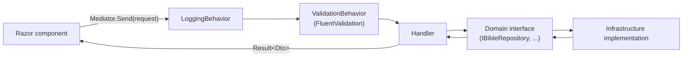
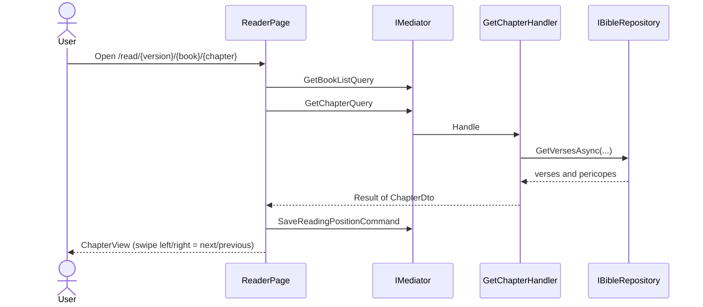
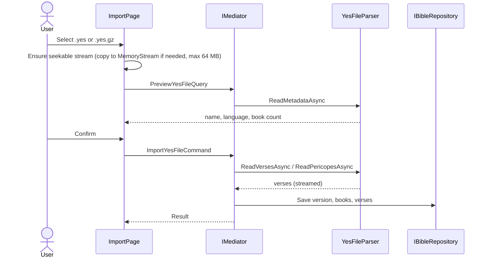
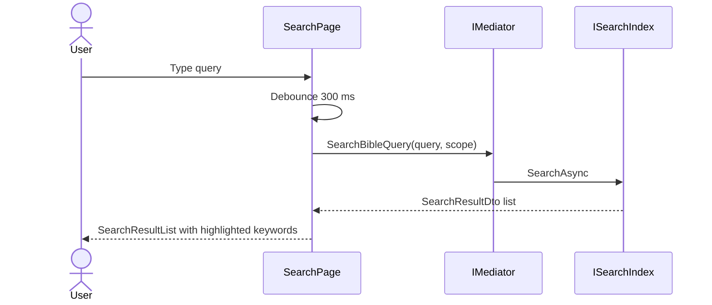
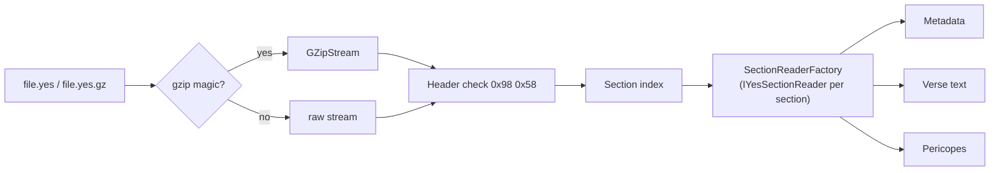

# OpenBible

> Offline-first **.NET 10 Blazor WebAssembly PWA** that ports the open-source [androidbible (Alkitab)](https://github.com/yukuku/androidbible) by Yuku to the web.

OpenBible reads Bible translations entirely on the client. After the first load, the app shell is served by a service worker and all scripture, search, bookmarks and highlights work without a network connection. Target platform: iOS Safari standalone PWA (also works in desktop and Android browsers).

- [Status](#status)
- [Features](#features)
- [Architecture](#architecture)
- [Runtime flows](#runtime-flows)
- [Verse addressing (ARI)](#verse-addressing-ari)
- [The `.yes` file format](#the-yes-file-format)
- [Mapping from androidbible](#mapping-from-androidbible)
- [Offline and PWA design](#offline-and-pwa-design)
- [Project structure](#project-structure)
- [Build, test and run](#build-test-and-run)
- [Testing strategy](#testing-strategy)
- [Roadmap](#roadmap)
- [Credits and license](#credits-and-license)

---

## Status

The solution builds with zero warnings and all tests pass. Implemented versus pending:

| Area | State |
|---|---|
| Domain model, ARI value object, repository contracts | Implemented |
| Application use cases (read, import, search, bookmarks, highlights, reading position) | Implemented |
| UI pages: Reader, Library, Import, Search; swipe navigation; dark mode; safe-area layout | Implemented |
| `.yes` header/metadata/verse parsing with transparent GZip | Implemented (basic) |
| `.yes` section readers (xref, footnote, pericope, ...) | Placeholders, not yet populated |
| Snappy decompression | Not implemented |
| Persistent storage (IndexedDB / SQLite WASM) | **Not implemented.** Repositories are currently in-memory, so imported data and user data are lost on reload |
| Sample scripture seeding so the reader works out of the box | Implemented |
| CI workflow, trimming/Brotli tuning, offline end-to-end verification | Pending |

See [PLAN.md](PLAN.md) for the authoritative checklist.

## Features

- **Reader**: chapter view, pericope headings, previous/next chapter by swipe or buttons, book selector, auto-resume of the last reading position.
- **Verse actions**: highlight with colors, toggle bookmark, copy text.
- **Library**: list installed versions, list bookmarks, delete a version.
- **Import**: preview a `.yes` / `.yes.gz` file (metadata) before importing it (64 MB limit).
- **Search**: debounced (300 ms) full-text search with scope filter (All / Old Testament / New Testament / Current book) and keyword highlighting.
- **PWA polish**: iOS safe-area insets, system dark/light mode plus manual toggle, service worker with cache-first strategy for published assets.

## Architecture

OpenBible uses **Onion (Clean) Architecture** with **CQRS through MediatR**. Dependencies only point inward.

```mermaid
flowchart TB
    subgraph Wasm["OpenBible.Wasm (Presentation)"]
        UI["Razor pages and components<br/>inject IMediator only"]
        SW["Service worker, manifest, JS interop"]
    end
    subgraph Infra["OpenBible.Infrastructure"]
        YES["YesFileParser + section readers<br/>GZip detection"]
        REPO["Bible / user-data repositories<br/>(in-memory today)"]
        IDX["SimpleSearchIndex"]
        SEED["SampleScriptureSeeder"]
    end
    subgraph App["OpenBible.Application"]
        UC["Commands, Queries, Handlers"]
        PIPE["LoggingBehavior, ValidationBehavior"]
        DTO["DTOs and Result&lt;T&gt;"]
    end
    subgraph Dom["OpenBible.Domain"]
        ENT["Entities and Value Objects<br/>VerseReference (ARI), VerseRange"]
        IFC["Contracts: IBibleRepository, IYesFileReader,<br/>ISearchIndex, IUserDataRepository"]
    end

    UI --> UC
    UC --> IFC
    UC --> ENT
    Infra -. implements .-> IFC
    Wasm -. registers in Program.cs .-> Infra
    Infra --> App
```

| Project | Responsibility | References |
|---|---|---|
| `OpenBible.Domain` | Entities, value objects, enums, exceptions, repository/reader contracts. No external dependencies except `MediatR.Contracts`. | none |
| `OpenBible.Application` | Use cases as MediatR requests, pipeline behaviors, DTOs, `Result<T>`. | Domain |
| `OpenBible.Infrastructure` | `.yes` parsing, search index, repository implementations, seeding. | Domain, Application |
| `OpenBible.Wasm` | Blazor WASM host, pages, components, CSS, service worker. Composition root (`AddApplication().AddInfrastructure()`). | Application (via `IMediator`), Infrastructure (DI registration only) |

Rules enforced by convention (details in [AGENTS.md](AGENTS.md)):

1. Razor components inject `IMediator` and never repositories or parsers.
2. Handlers return DTOs or `Result<T>`; domain entities never reach `.razor` files.
3. Every I/O method is `async Task`, takes a `CancellationToken`, and non-UI layers use `ConfigureAwait(false)`.
4. No sync-over-async; `.yes` files are streamed section by section, never loaded fully into a byte array.
5. One type per file; tests never touch the network.

## Runtime flows

### Request pipeline

Every UI action becomes a MediatR request that passes through the same pipeline.



### Reading a chapter



Opening `/` queries `GetReadingPositionQuery` and redirects to the last position (or a default chapter). Routes: `/`, `/read`, `/read/{VersionId}/{Book:int}/{Chapter:int}[/{Verse:int}]`.

### Importing a `.yes` file



### Search



The upstream search semantics (AND over space-separated terms, substring match, case-insensitive, normalized query and text) are the reference; see the androidbible [search guide](https://github.com/yukuku/androidbible/blob/develop/docs/modules/search.md).

### Bookmarks and highlights

Long-pressing a verse opens `VerseActionSheet`, which sends `SetVerseHighlightCommand` or `ToggleBookmarkCommand` (copy uses a JS helper). The Library page lists them via `GetBookmarksQuery`. Markers are keyed by the verse ARI, as in androidbible's [markers guide](https://github.com/yukuku/androidbible/blob/develop/docs/modules/markers.md).

## Verse addressing (ARI)

A verse is identified by a 32-bit **ARI** (Alkitab Resource Identifier):

```
ari = (bookId << 16) | (chapter << 8) | verse
```

| Field | Range | Notes |
|---|---|---|
| `bookId` | 0-65 | zero-based, Genesis = 0, Revelation = 65 |
| `chapter` | 1-based | 0 means the whole book |
| `verse` | 1-based | 0 means the whole chapter |

Example: Genesis 1 (whole chapter) is `0x000100` = `256`. All bit math is encapsulated in the `VerseReference` value object (`ToAri()` / `FromAri(int)`); Application and UI code never shifts bits.

## The `.yes` file format

`.yes` (YES2) is the single-file Bible translation format of androidbible. Key facts, based on the upstream [binary formats guide](https://github.com/yukuku/androidbible/blob/develop/docs/binary-formats.md):

```
[Header]         8 bytes, starts with 0x98 0x58
[Section index]  count + (name, offset, attributes size, content size) per section
[Sections...]    version info, book info, verse text, pericopes, xrefs, footnotes
[Footer]         1 byte
```

- Numbers are **big-endian** (Java `DataInputStream`); OpenBible reads them via `BigEndianBinaryReader`.
- Verse text is UTF-8 or ASCII, may be Snappy-compressed and is addressed per book/chapter through offset tables for random access.
- A whole file may be GZip-wrapped (`.yes.gz`); OpenBible detects the `0x1F 0x8B` magic and wraps the stream in `GZipStream`.
- Inline formatting codes (red letters, footnote markers, ...) are part of the verse text; see the upstream [text rendering guide](https://github.com/yukuku/androidbible/blob/develop/docs/text-rendering.md).



Each section has its own `IYesSectionReader` so new sections can be added without modifying the core parser (Open/Closed). Known gaps: the xref/footnote readers are placeholders, Snappy decompression is missing, and the section names in `YesFileConstants.Sections` must be verified against the upstream names (`versionInfo`, `booksInfo`, `text`, `xrefs`, `footnotes`, `pericopies`) before real-world files are imported. Changes to the parser or ARI logic should be discussed first.

## Mapping from androidbible

| androidbible (Android) | OpenBible (.NET 10) |
|---|---|
| `Activity` / `Fragment` | Blazor page (`Pages/ReaderPage.razor`) |
| Custom view / adapter | Blazor component (`Components/ChapterView.razor`) |
| `ViewModel` / `LiveData` | MediatR query + DTO |
| `Ari` utility | `VerseReference` value object |
| `Yes2Reader` | `YesFileParser` implementing `IYesFileReader` |
| `InternalDb` / SQLite | `IBibleRepository` / `IUserDataRepository` (in-memory now; IndexedDB or SQLite WASM planned) |
| `SharedPreferences` | `IUserDataRepository` (reading position, theme) |
| Version ids `internal`, `preset/<name>`, `file/<path>` | `BibleVersion` ids in the catalog |
| `DataInputStream` (big-endian) | `BinaryPrimitives.ReadInt32BigEndian` |

Upstream references: [architecture](https://github.com/yukuku/androidbible/blob/develop/docs/architecture.md), [storage](https://github.com/yukuku/androidbible/blob/develop/docs/storage.md), [versions](https://github.com/yukuku/androidbible/blob/develop/docs/modules/versions.md).

## Offline and PWA design

- `manifest.webmanifest` with `display: standalone` and Apple meta tags in `index.html`.
- `service-worker.published.js` precaches published assets with a cache-first strategy.
- `openbible.css` uses `env(safe-area-inset-*)` and `prefers-color-scheme`; `MainLayout` adds a manual theme toggle and an `ErrorBoundary`.
- No runtime network calls: tests and app logic must run with zero connectivity.
- Persistence is the main outstanding offline requirement (see Status).

## Project structure

```
OpenBible.sln
Directory.Build.props        shared settings (net10.0, nullable, warnings as errors)
Directory.Packages.props     central package management
global.json                  .NET SDK pin
src/
  OpenBible.Domain/          entities, value objects, contracts
  OpenBible.Application/     use cases, behaviors, DTOs, Result
  OpenBible.Infrastructure/  YesFile parser, repositories, search, seeder
  OpenBible.Wasm/            Blazor WASM host (Pages, Components, Layout, wwwroot)
tests/
  OpenBible.Domain.Tests/
  OpenBible.Application.Tests/
  OpenBible.Infrastructure.Tests/
PLAN.md                      milestone checklist
AGENTS.md                    architecture rules and porting guide
```

## Build, test and run

Requires the .NET 10 SDK (see `global.json`).

```bash
dotnet restore
dotnet build --no-incremental     # zero warnings, zero errors
dotnet test --no-build            # all tests, fully offline
dotnet run --project src/OpenBible.Wasm
```

## Testing strategy

xUnit, NSubstitute and FluentAssertions. Domain tests cover ARI math and value-object equality; Application tests mock the Domain contracts to test handlers; Infrastructure tests exercise the parser and repositories. No test performs network access.

## Roadmap

Open items, tracked in [PLAN.md](PLAN.md): real section readers and Snappy, persistent storage, `GetVerseQuery` and version-metadata query, import progress and search pagination, the `.yes` format ADR and a sample fixture, CI workflow, and end-to-end offline verification.

## Credits and license

Open-source under the [MIT License](LICENSE). Based on logic and specifications from [androidbible (Alkitab)](https://github.com/yukuku/androidbible) by Yuku.
